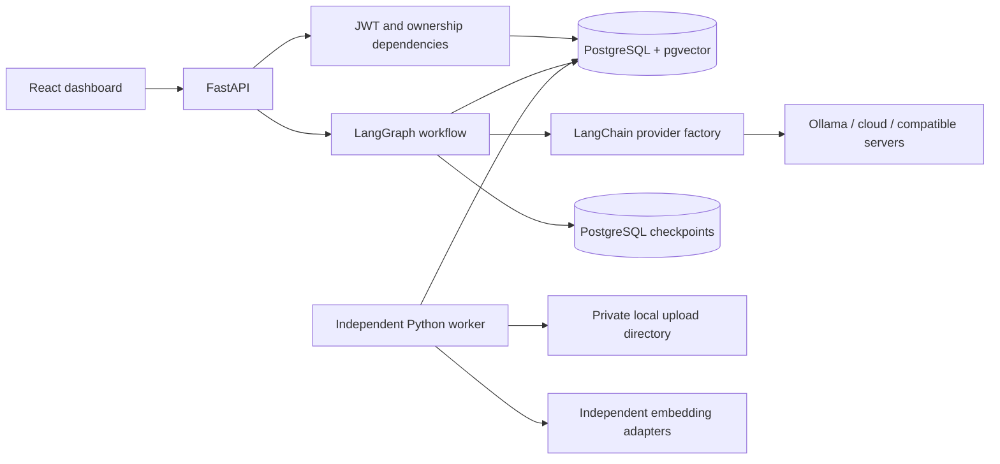

# Architecture

The React SPA calls a single `/api/v1` FastAPI service. Access dependencies resolve the user. Resource services perform authorization and validation. SQLAlchemy repositories are intentionally expressed as small service queries rather than generic CRUD abstractions. The backend has one asynchronous SQLAlchemy session per ordinary request and separate short-lived sessions for graph execution and worker operations.

`services/chat.py` supplies request-specific execution services. `ai/graphs/workflow.py` wires nodes from `nodes.py`. Graph state contains question, retrieval query, result, sources and status; it contains no API credentials, ORM sessions or entire accumulated history. Each generation loads a bounded history window from canonical message rows. Checkpoint thread IDs are server-generated `owner_uuid:conversation_uuid`; callers cannot choose thread IDs.

Authentication uses Argon2, HS256 access JWTs and opaque refresh cookies. Only refresh-token digests are stored. Rotation locks the token row, revokes the old token and issues a replacement in the same family. Reuse revokes the family and commits that revocation even when returning an error. Logout revokes refresh capability; already-issued access JWTs expire within 15 minutes rather than being centrally revoked.

Provider definitions are global and administered; user documents/chatbots/conversations are owner-scoped. Credentials use Fernet encryption. URLs must match an administrator-controlled origin allowlist. Local providers must be loopback servers. Network calls for Ollama/OpenAI-compatible/Gemini explicitly disable redirects and environment proxies; Anthropic uses its SDK transport against the configured allowed origin. Only trusted administrators should control that origin. Do not treat the allowlist as a sandbox against a malicious administrator or compromised approved service.

Uploads are stored under UUID filenames outside frontend static paths. Filenames are display metadata. Size/type checks occur before durable queuing; parsing and embedding occur in a worker. Files and database rows cannot share an atomic transaction: an API process crash can leave orphan files. A maintenance cleanup should reconcile unreferenced files after a grace period; never expose the upload directory as static content.

The worker uses `FOR UPDATE SKIP LOCKED`, attempts, time-based leases and random fencing tokens. External extraction/embedding happens outside open database transactions. Publishing obtains a knowledge-base lock and verifies generation/token before replacing chunks atomically. Crashes recover after lease expiration, at most three attempts. Files are searchable only when the document is `ready` and the chunk embedding/generation matches the current knowledge base.

General responses stream immediately. Strict responses are validated before display. Raw HTML is disabled in chat Markdown and remote images are blocked to avoid automatic external requests from model-generated image URLs. On interruption, canonical assistant rows remain `failed`/`interrupted`, with partial content where available. A busy conversation lease prevents overlapping generations; abandoned leases are recovered by the next authorized request. API/worker shutdown does not magically resume a model token stream.

The initial vector strategy is exact cosine search with a composite space filter and a guarded distance expression, chosen for correctness across dimensions. The included `langchain-postgres` package is available for future integration, but the application owns its vector schema to preserve document authorization, version filtering and transactional ingestion. It does not create a second LangChain collection store.

Future organization tenancy should introduce organization membership and scope every access path before exposing shared resources. Billing, organizations, autonomous agents and external queues are outside this implementation.
