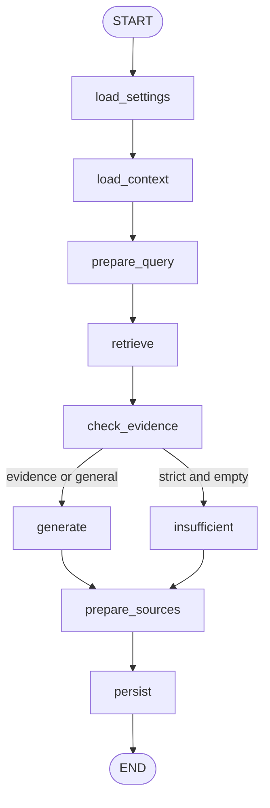

# LangGraph workflow

`ChatState` in `ai/graphs/state.py` is a TypedDict holding only serializable current question/query, conversation ID, evidence flag, answer, sources, message ID and status. Sessions, model clients, credentials and bounded history live in an ephemeral service outside checkpoints.

`workflow.py` builds edges, `nodes.py` contains small nodes, `services/chat.py` supplies database/model operations, and `rag/grounding.py` checks extracts. Conditional routing avoids chat-model invocation without strict evidence. General mode still generates when retrieval is empty.

`get_stream_writer()` emits custom text events. The API consumes `custom` and `updates` streams, then reads final checkpoint state for completion sources. SSE and non-streaming HTTP share the graph implementation.

The application lifespan opens `AsyncPostgresSaver` from `langgraph-checkpoint-postgres`. Install its schema with `python -m app.db.setup_checkpoints`. Application ORM data uses asyncpg; the saver independently uses supported psycopg. Checkpoint installation is explicit, not an automatic application schema mutation on every startup.

Thread identity is server-generated `owner_uuid:conversation_uuid`; API ownership is checked first. Each invocation resets result/evidence fields so old passages are never reused for a new question. Bounded history is reloaded from canonical messages. Checkpoints include passages/results and must be treated as sensitive data.

The initial API does not automatically resume interrupted LLM streams. After process loss, the busy lease expires and the next request marks abandoned pending responses interrupted. Canonical assistant IDs are run UUIDs; persistence verifies the active run token. Conversation/bot deletion explicitly removes checkpoint threads. A future retention job should prune old versions and reconcile orphan threads after cross-operation failures.

Historical message lists are not duplicated in state. Add tools, verification or approvals as graph nodes rather than introducing unnecessary autonomous agents. See the [LangGraph persistence documentation](https://docs.langchain.com/oss/python/langgraph/add-memory). Tests use `InMemorySaver` solely for isolation.
